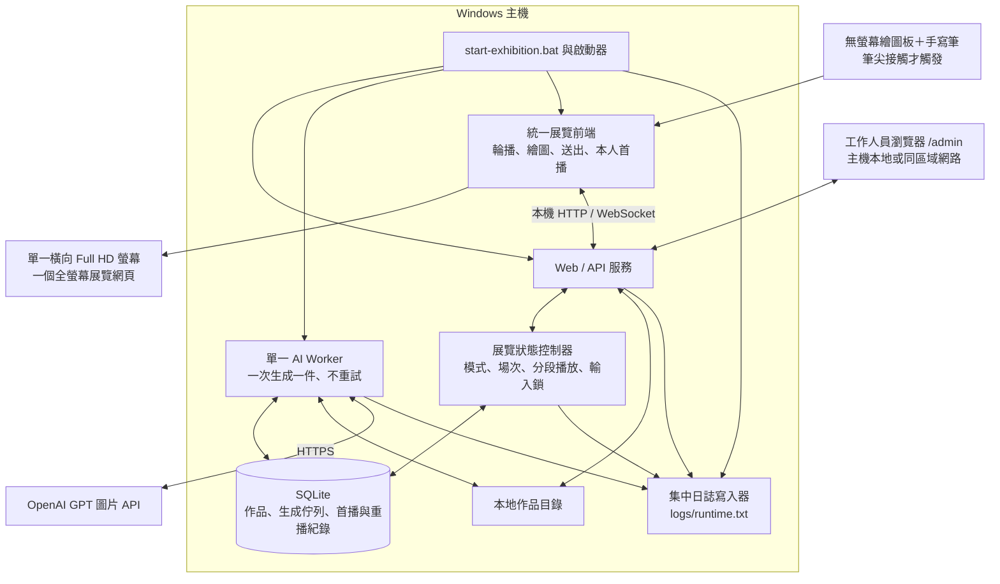
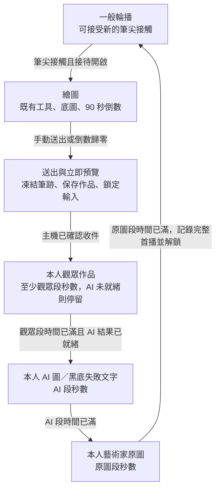

# 「人工對畫(話)」互動展覽系統架構

更新日期：2026-10-28  
文件狀態：v2.0 架構確認版，採單螢幕與無螢幕繪圖板。

本版記錄已討論的新流程及其架構設計。單螢幕主流程（筆尖開始、本人首播鎖、三段計時、最近 K 件輪播、五次 Esc 結束）已實作，並以假 AI 端到端驗證；實際繪圖板、真實 OpenAI 生成與交付機全螢幕視窗仍待現場驗證。原始規格完整保存在 [v1.0 封存](archive/system-architecture-v1.0.md)，介面見 [實作契約](implementation-contract.md) 第 0 節。

## 1. 作品與已確認需求

作品名稱為「人工對畫(話)」，視覺方向採 Postmodernism（後現代主義）。觀眾透過手寫筆與無螢幕繪圖板，在展覽螢幕上的半透明藝術家底圖上作畫；同一螢幕也負責逐張展示觀眾、AI 與藝術家作品。

| 項目 | v2.0 需求 |
| --- | --- |
| 主機 | 一台 Windows 主機。 |
| 展示 | 一個橫向 1920 × 1080 螢幕、一個全螢幕網頁，切換輪播與繪圖模式。 |
| 輸入裝置 | 無螢幕繪圖板，使用手寫筆，直接連接主機。 |
| 開始條件 | 只有筆尖接觸繪圖板才開始；懸停與單純移動不觸發。 |
| 一般輪播 | 只循環輪播最近 K 件作品，K 由後臺調整。 |
| 每件播放單位 | 該觀眾純筆跡 → 同一件的 AI 圖或失敗文字版 → 該場次對應的藝術家原圖。 |
| 每段時間 | 觀眾、AI、原圖各預設 10 秒，後臺可分別調整。 |
| 作畫 | 沿用既有繪製介面與工具，預設 90 秒倒數、後臺可調，手動送出或到時自動送出。 |
| 本人首播 | 送出後立即展示本人觀眾作品，背景執行 AI，再播放本人 AI 與原圖；完整一輪結束才重新接受開始操作。 |
| AI 尚未就緒 | 停留在本人觀眾作品，至少展示該段秒數，待 AI 有成功或失敗結果後再切換。 |
| AI 失敗 | AI 段使用黑底與「此刻，機器沉默。」，照常計時後播放原圖，再解鎖。 |
| 本地保存 | 保留所有已收件觀眾畫作、成功 AI 圖片與對應資料；K 只限制重播範圍，不刪除檔案。 |
| 啟動／日誌 | 沿用單一 `start-exhibition.bat` 啟動，以及 `logs/runtime.txt` 持續追加的執行日誌。 |
| 後臺 | 沿用主機本地或同網段裝置的 `/admin`，免登入、限同網段來源；不要求額外監控螢幕。 |
| 現場關閉 | 在展覽螢幕上 5 秒內連按 5 次 Esc，即結束整個展覽程式；長按不重複計數。 |

本版取代平板輸入與三個展示視窗。觀眾的繪製及觀看都在同一個展覽螢幕完成，非空白作品的換場限制改由本人完整首播決定。

## 2. 整體架構

前端以單一展覽入口整合現有繪圖與展示元件，建議路徑為 `/exhibition`。正式路由、API 與資料欄位在實作契約遷移時定義，本文件先確認行為與責任。

| 元件 | 責任 |
| --- | --- |
| 統一展覽前端 | 保持全螢幕，顯示輪播／繪圖／本人首播；接收筆尖事件、保存草稿、預載圖片、回報真正顯示的段落。 |
| 展覽狀態控制器 | 由後端作為唯一狀態來源，管理開始條件、目前場次、首播擁有者、分段計時與輸入鎖。 |
| Web / API | 沿用設定、原圖版本、場次、收件、圖片提供、後臺與健康檢查，加入統一展覽狀態。 |
| AI Worker | 沿用既有生成、逾時、保存及失敗流程；結果回到對應作品，不直接搶換畫面。 |
| SQLite／本地檔案 | 沿用作品與生成紀錄，保存首播、重播、目前段落及恢復狀態，圖片持續留存。 |
| 啟動器 | 啟動本地服務、Worker、日誌與一個全螢幕展覽視窗，恢復舊資料；不再等待三個展示角色。 |
| 後臺 | 設定秒數與 K，監看場次、生成、輪播、輸入鎖、磁碟及 TXT 日誌。 |

React／TypeScript／Canvas 2D、Python／FastAPI、SQLite 與既有共用前端工具持續沿用。開發與驗證依專案規則使用 Miniconda `agent-use-latest`。

## 3. 模式與輸入鎖

### 3.1 一般輪播時的開始操作

- 一般輪播可在任一段被筆尖接觸中斷，進入繪圖；懸停、移動與放開筆尖都不建立新場次。
- 同一時刻只有一個觀眾場次。開始請求由主機以原子方式檢查接待開關、目前模式及鎖定狀態，避免快速重複接觸建立多場。
- 建議喚醒的第一下只切換介面，放開筆尖後下一筆才開始留痕，避免開場誤畫或誤點工具。這是介面細節建議，不額外要求觀眾再按一次開始。
- 畫布與原圖就緒後啟動 90 秒倒數，不讓畫面載入吃掉作畫時間；重新整理不重設主機保存的截止時間。
- 繪圖板的驅動、筆尖事件與螢幕映射需在實際設備驗證；滑鼠保留供開發測試，正式接觸判定依繪圖板輸入處理。

### 3.2 本人完整首播的鎖定

- 送出後，畫面固定在該場次的作品，鎖定到「本人觀眾 → 本人 AI → 本人原圖」全部播完。
- 輸入鎖由主機保存，重新載入、重新連線或另開前端不能繞過；前端同時抑制繪圖板開始事件。
- 鎖定期間的接觸不排隊，不在解鎖後補觸發。解鎖後需先處於筆尖放開狀態，再以新的接觸開始下一場。
- 其他 AI 工作完成、歷史輪播更新或 K 改變，都不能取代本人的正在播放內容。
- 本人首播結束後立即回到可開始的一般輪播，不再另外加上原本非空白提交的固定 10 秒換場。

### 3.3 例外場次沿用的規則

- 空白、全部擦除或復原至空白時不保存作品、不送 AI；仍有任何有效筆跡，即使一個點，也照常生成。
- v1.0 的空白、放棄與磁碟捨棄場次沒有正式作品可作本人首播；目前保留其預設 10 秒例外換場，再回一般輪播。若要改成立即回輪播，可另調整此項。
- 資料磁碟可用空間低於 2% 時，沿用 v1.0 已核定規則：新提交標為 `discarded`，不存檔、不建 AI 工作，記錄 WARNING；已收件作品繼續處理，不自動刪除舊圖。
- 非容量門檻造成的保存失敗，不假稱收件成功；保留凍結作品並重送，尚未完成收件時不解鎖建立新場次。

## 4. 繪圖與提交

沿用白色 16:9 邏輯畫布（1920 × 1080）、藝術家原圖完整置中補邊、底圖初始 30% 不透明度，後臺可調。工具為畫筆、色票、粗細、橡皮擦、復原／重做、清空及送出；色票不含純白，橡皮擦只移除筆跡。

- 筆尖座標轉換到邏輯畫布；視覺縮放不改變筆跡儲存座標。壓力筆刷或筆側鍵功能不因裝置改為手寫筆就自動新增。
- 觀眾端倒數清楚可見，預設 90 秒；歸零立即中斷正在進行的筆畫並自動送出，無人操作也不重設。
- 手動與自動送出使用同一場次與冪等識別，近乎同時觸發只收一件。
- 送出時凍結筆跡並立即顯示白底純觀眾作品預覽。預覽不混入半透明底圖，原本的工具列與倒數退出畫面。
- 主機保存完成後，預覽轉為正式本人觀眾段；以正式顯示回報開始段落計時。畫面可以連續呈現，不要求重新閃一次圖片。
- 草稿仍以場次寫入本機 IndexedDB；主機明確確認收件後才清除。服務暫時斷線自動重連與補送，不設補傳期限。
- 草稿遺失且場次已到期時標為 `abandoned`；未到期可依既有機制接續，工作人員也可放棄場次。

收件仍以檔案落盤及 SQLite 交易為準；成功非空白作品建立唯一的作品、AI 工作與首播待播紀錄。重送回覆原識別，不重建工作或再次觸發付費生成。

## 5. 本人首播、最近 K 件輪播與計時

### 5.1 本人送出後的播放單位

| 段落 | 內容與切換條件 |
| --- | --- |
| 觀眾段 | 本人的白底純筆跡，預設至少 10 秒；AI 尚未就緒時繼續停留。 |
| AI 段 | 同件 AI 圖，或黑底「此刻，機器沉默。」；實際顯示後計預設 10 秒。 |
| 原圖段 | 該場次綁定版本的藝術家原圖，以 100% 不透明度展示；實際顯示後計預設 10 秒。 |
| 結束 | 原圖段達時間後才標記完整首播、解除輸入鎖，將作品加入一般輪播的候選清單。 |

AI 在觀眾段前就完成，也要等觀眾段滿秒數。AI 遲到則延長觀眾段，不略過 AI 或原圖段，也不借用別人的 AI 圖。

等待時沿用「機器正在回話⋯」的藝術感提示，可使用時間估算進度；估算不得冒充 API 的真實生成百分比。提示附於當前本人觀眾作品，不依賴額外螢幕。

### 5.2 最近 K 件的一般輪播

- 依主機收件順序選出最近 K 件已完成首播的作品，按收件先後由舊到新循環。成功圖與失敗文字版都可輪播，原圖取各件所綁定的版本。
- 每件固定以「觀眾 → AI → 原圖」為單位。段落時間與本人首播使用同一組後臺設定；每輪開始時綁定秒數，中途修改不截斷當前段落。
- 新觀眾開始作畫時，暫停一般輪播並保存被中斷項目。本人首播結束後，若該項仍在最近 K 件內，從該件的觀眾段重播；若已移出範圍，按更新後清單接續。
- 修改 K 在下一個播放單位生效；不打斷作畫或本人的鎖定首播。K 的初始數值尚未指定，由後臺配置。
- 沒有任何歷史作品時，顯示原圖與符合展覽視覺的作畫邀請，仍可透過筆尖接觸開始。
- K 不刪檔、不取消首播、不觸發重新生成 AI。已播作品反覆輪播只讀取本地結果。

### 5.3 首播佇列與歷史輪播分開

AI 生成佇列、尚未完成首播的作品、最近 K 件重播清單是不同概念。

- 新觀眾送出後，其本人首播優先占用畫面；生成仍由單一 Worker 依工作佇列執行，不取消或重複既有請求。
- 舊系統若有尚未播完的作品，持續保留其首播資格。沒有本人鎖定首播時，優先依序處理這些項目，再進入一般歷史重播。
- 首播項目不受 K 限制，不能因新增作品或設定較小的 K 而消失。完整三段結束才標記首播完成。
- 重播另外記錄播放次數與段落歷程，不重新建立作品、AI 工作或新的首播項。

### 5.4 時間與中斷恢復

- 主機統一保存模式、作品識別、首播／重播種類、目前段落、時間與輸入鎖；前端回報圖片已載入並實際顯示。
- 單一前端也不能只靠瀏覽器計時器解鎖；服務端確認該件三段的有效展示時間都滿足，才開放下一場。
- 圖片未載入、視窗斷線、版本錯誤或服務重啟時，不把未實際呈現的時間當作已播。恢復時重播未完成段落並重計該段時間。
- 本人首播中斷時保留作品擁有者與輸入鎖，恢復後繼續該件，不誤切到歷史作品或直接開放新場。
- 以播放識別及版本拒絕過期回報，避免舊載入結果、舊計時器或重複完成通知切錯畫面。

## 6. AI、本地保存與 TXT 日誌

### 6.1 沿用的 AI 設定

採既有 OpenAI GPT 圖片 API 介接，以純觀眾作品為參考自由重繪。模型、品質、尺寸、提示詞與逾時沿用現有配置及後臺調整方式；既有預設為 `gpt-image-2.5-sunburst`、`medium`、`2048x1152`、180 秒。

- 一次生成一件；任何錯誤或逾時都不重試。每件只發出一次付費生成請求。
- 成功結果先保存本地再提供展示；失敗以黑底文字完成 AI 段，不讓觀眾永遠卡在等待。
- Worker 重啟時沿用既有處理：已取得完整結果者歸檔，其餘中斷工作轉失敗展示，不重送雲端。
- 逾時後抵達的舊結果不能改寫已定版的失敗展示，其他作品的結果也不能替換當前本人內容。
- 更新預設提示詞時，移除「平板／手指」的舊裝置描述；使用者已保存的自訂提示詞保留，由後臺決定是否調整。
- 本版調整介面與播放流程，不自動把 AI 生成風格改為後現代主義。Postmodernism 仍是介面設計方向。

### 6.2 本地保存

沿用 `data/` 的 SQLite、原圖版本與 `submissions/<id>/` 作品目錄。透明筆跡、白底作品、實際 AI 輸入、AI 輸出及 metadata 都保留，播放後與移出 K 件輪播範圍後也不自動刪除。

AI 結果若有格式／尺寸轉換，原始輸出一併保留。失敗時保存狀態與失敗文案，不能將黑底文字版誤標為成功 AI 圖片。置換 `base.webp` 只影響之後的場次，舊作品維持原圖版本對應。

資料庫需要擴充統一展覽狀態、三段播放與重播紀錄；具體 schema 在實作階段定案。既有作品、生成工作、首播狀態與歷史紀錄不得因遷移重設或刪除。

### 6.3 日誌

沿用 UTF-8 `logs/runtime.txt`，由集中寫入器持續追加，重啟不清空。增加記錄筆尖喚醒、輪播中斷／恢復、輸入鎖定／解鎖、首播與重播種類、每段開始／結束、K 及段落設定版本。

事件附場次、作品、AI 工作及播放識別，不逐筆記錄座標或正常心跳。日誌不包含金鑰、授權資訊或圖片 Base64。後臺可查閱、增量更新與下載，作品和播放狀態仍以正式資料庫及檔案為準。

## 7. 後臺設定與現場操作

| 設定 | 預設／規則 |
| --- | --- |
| 作畫秒數 | 90 秒，新場次生效。 |
| 觀眾段秒數 | 10 秒，至少滿此時間；本人等待 AI 時可延長。 |
| AI 段秒數 | 10 秒，成功圖與失敗文字版相同。 |
| 原圖段秒數 | 10 秒，結束後才完成本人首播並解鎖。 |
| 最近作品數 K | 可調正整數，目前預設 10；只影響一般重播。 |
| 底圖不透明度 | 30%，只影響作畫參考層。 |
| AI 模型／品質／尺寸／提示詞／逾時 | 沿用現有後臺設定與版本快照。 |
| 接待開關 | 沿用即時暫停／恢復；關閉時不開新場，進行中的作畫與本人首播照常完成。 |
| 例外換場秒數 | 沿用 10 秒，僅供空白、放棄與未保存的捨棄場次使用。 |

後臺免登入、限本機或同網段來源，沿用既有網路存取限制。保留工作人員放棄場次、AI 試生成、日誌與收展操作；試生成結果不進觀眾播放清單。

監看內容由三螢幕連線改為單一展覽頁的模式、連線、當前場次／作品、段落、首播鎖與剩餘時間；仍保留 AI 佇列、待首播件數與磁碟狀態。

維護入口可沿用右上角熱區機制，需避免與一般筆尖喚醒及工具點選互相誤觸；具體交互於實作驗證。維護操作不是觀眾繞過本人首播鎖的入口。

## 8. BAT 啟動與故障恢復

`start-exhibition.bat` 仍是日常唯一啟動入口。前端預先建置於本地，由後端提供；正式開展不依賴現場安裝套件、外部 CDN 或重新編譯。

1. 取得單一執行鎖並啟動日誌，確認執行環境、原圖、前端檔案、資料路徑與服務埠。
2. 啟動 Web／展覽控制器與 AI Worker，載入既有作品、場次、輸入鎖、首播佇列與輪播設定。
3. 讀取單一展覽螢幕配置，啟動一個專用全螢幕視窗；等待展覽前端真正就緒。
4. 若有未完成的作畫／提交／本人首播，優先恢復；否則從一般輪播或無作品待機開始。

不再檢查三個螢幕、啟動三個角色視窗或等待三角色同步。繪圖板驅動與筆尖對應在首次部署驗證；已運作系統重複執行 BAT 時沿用現有程序，避免重複生成與播放。

服務斷線時保留草稿／凍結作品或當前畫面，恢復後取得主機狀態，自動補送或續播。工作人員後臺關閉不影響展覽；結束展覽時保存所有未完成狀態並刷新日誌，下次啟動續接。

收展沿用先暫停接待、完成尚未首播的作品，再結束服務的順序。歷史循環不屬於待清空的首播佇列，不能為了等待循環「播完」而永遠無法收展。

現場也可以在展覽螢幕上 5 秒內連按 5 次 Esc 立即結束展覽程式：展覽頁先保存作畫草稿再要求結束；啟動器另以鍵盤偵測作為備援，只在展覽視窗位於前景時計數，Web 服務沒有回應時也能關閉。未完成的作畫、提交與本人首播照常保存，下次啟動續接。展覽頁不使用 HTML5 全螢幕（由 kiosk 視窗負責全螢幕），以免瀏覽器攔下 Esc。

## 9. 實作遷移與驗收

### 9.1 預計調整範圍

| 現有部分 | v2.0 方向 |
| --- | --- |
| `frontend/src/draw/` | 沿用畫布、工具、倒數與草稿；輸入以手寫筆為主，納入統一入口與開始／鎖定規則。 |
| `frontend/src/display/` | 從三角色各顯示一張改為單頁逐段播放，加入本人首播、歷史重播及中斷恢復。 |
| `backend/playback/` | 改為展覽模式控制、本人擁有權、三段計時、首播與 K 件重播；移除三角色就緒門檻。 |
| `backend/services/`、API 與共用型別 | 場次開始要檢查展覽模式及首播鎖，提交後銜接本人首播；調整設定、快照、健康狀態與 WebSocket 契約。 |
| `frontend/src/admin/` | 新增三段秒數與 K，改為單頁狀態監看，保留已有操作。 |
| `launcher/` 與健康檢查 | 只配置、啟動及監看一個展覽視窗，沿用單一 BAT。 |
| AI、作品與日誌 | 沿用現有流程與資料，調整裝置描述及新增事件，不重生歷史圖片。 |

資料遷移先保存可恢復備份，再新增需要的狀態與欄位。保留舊作品、未首播項及歷史紀錄，區分舊三角色播放紀錄與新分段播放紀錄。舊 API 是否保留相容入口，在新版實作契約中逐項決定。

### 9.2 驗收重點

- 一台 Windows 主機、一個橫向 Full HD 螢幕與無螢幕繪圖板，單一 BAT 可準備展覽。
- 筆尖懸停／移動不切模式；一般輪播時筆尖接觸只建立一個場次，並進入既有繪圖介面。
- 手動送出、倒數歸零及同時觸發皆只收件一次，畫面立即顯示本人純筆跡。
- AI 早於觀眾段完成時仍滿足觀眾段秒數；AI 較慢時保留本人圖，其他結果不能搶換畫面。
- 本人觀眾、AI、原圖三段各滿配置秒數才解鎖，AI 失敗同樣走完黑底文字與原圖段。
- 鎖定期間接觸、連點、持續壓筆、重新載入或重連都不提前開新場；解鎖後需新的接觸事件。
- 一般輪播只選最近 K 件，順序為每件觀眾 → AI → 原圖；K 改變不打斷本人首播、不刪檔、不漏首播。
- 一般輪播被繪圖中斷後，依更新後清單重播被中斷單位；尚未首播的舊作品仍保留播放資格。
- 作畫、提交、本人首播各階段重啟，資料與模式可恢復；未實際顯示的時間不能算作完成段落。
- 既有圖檔、設定、AI 工作、播放紀錄及 TXT 日誌在遷移後仍保留，重播不產生額外付費生成。
- 空白與低磁碟等 v1.0 例外仍依保留規則完成，不誤鎖在不存在作品的首播流程。

## 10. 待補齊的細節

以下不影響已確認的單螢幕主流程，實作前或現場驗證時再定案：

- 最近作品數 K 的正式初始值（目前程式預設 10）。
- 實際繪圖板型號、Windows 驅動、筆尖事件與筆板／螢幕映射。
- 喚醒第一下只切模式、不留筆跡的介面建議，以及維護入口在單頁中的配置。
- 空白、捨棄與放棄場次是否繼續保留 v1.0 的 10 秒例外換場，或改成立即回一般輪播。
- 後現代主義介面的最終排版、色票、字體與藝術家文字；沿用第一版無聲音與無背景音樂的範圍。
- 新版完整 API、資料遷移與測試契約，以及交付機的單視窗自動全螢幕驗證。

作品保存／公開展示／傳送至 AI 的現場說明、AI 成本與實際生成耗時、備份與匯出等未變更事項，持續沿用既有決定及後續展場規劃。
