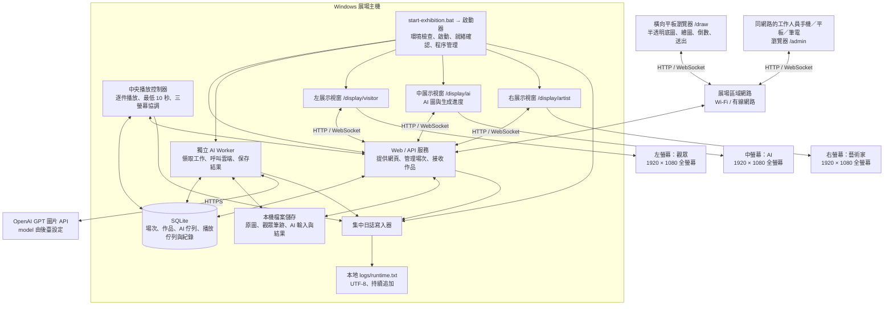
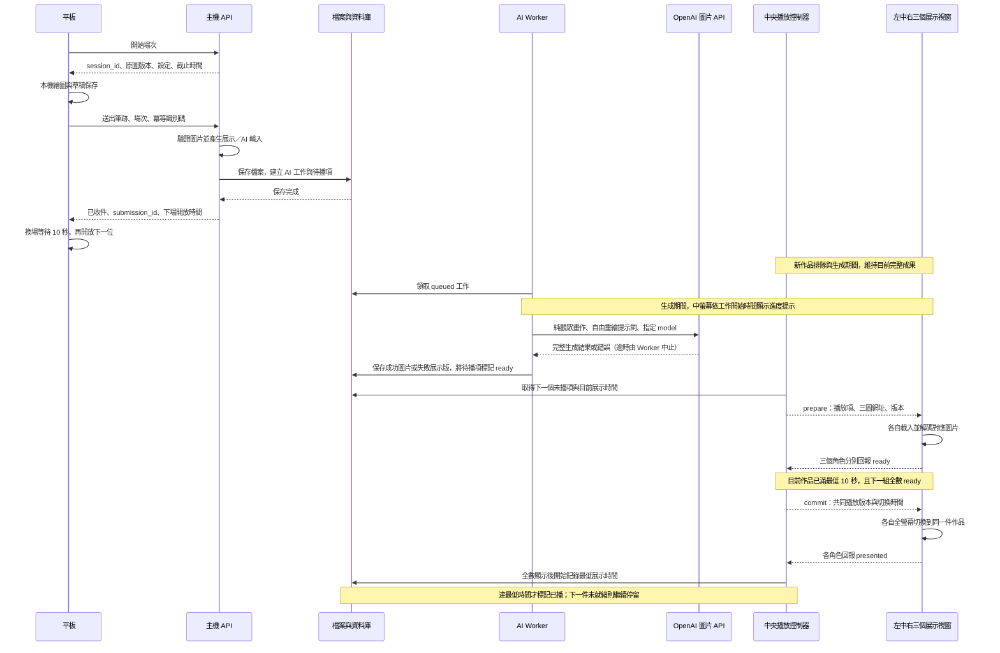

# 「人工對畫(話)」互動展覽系統架構

更新日期：2026-10-27  
文件狀態：v1.0 定版，可進入實作；以本版作為開發基準，之後的確認與變更以新版本號更新本文件。v0.5 納入單一 BAT 啟動整套本地系統、前端預先建置、環境檢查與三螢幕自動就緒流程；v0.6 納入審閱後的決定：不審查內容、單件生成與中螢幕進度提示、後臺免登入限同網段、平板可為 iPad、磁碟 2% 門檻、斷線自動重連與維護入口。第 10 節列出仍待討論的項目，以及依建議補充、可再調整的決定。

## 1. 目標與已確認需求

觀眾在平板上，以藝術家提供的圖片作為半透明底圖進行臨摹。作品送出後，主機保存觀眾畫作，交由雲端 AI 參考並重繪，再於主機連接的大螢幕展示對照結果。

作品名稱為「人工對畫(話)」，視覺概念採 Postmodernism（後現代主義）。

| 項目 | 已確認內容 |
| --- | --- |
| 作品名稱／視覺 | 人工對畫(話)；Postmodernism（後現代主義），藝術導向的互動展覽。 |
| 藝術家原圖 | 目前暫用專案根目錄的 `base.webp`，未來可替換。 |
| 平板 | 一台，橫向擺放，使用手指觸控；硬體尚未選定，可能是 iPad（4:3）或其他平板，螢幕比例不限。以瀏覽器網頁全螢幕執行，由現場志工手動開啟。 |
| 臨摹方式 | 白色畫布，藝術家底圖初始不透明度 30%，可由後臺調整；觀眾在上方畫作。 |
| 繪圖工具 | 畫筆、色票、粗細、橡皮擦、復原／重做、清空、送出。 |
| 多點觸控 | 多根手指同時接觸畫布時，每根手指各自畫出筆跡，不做手掌排除。 |
| 畫布 | 固定 16:9；原圖保持比例、完整置中補邊。平板螢幕不是 16:9 時，畫布等比例置中，其餘空間配置工具列。 |
| 作畫時間 | 每位預設 90 秒，畫面顯示倒數；時間長度可由後臺調整。 |
| 提交 | 觀眾可按「送出」提前提交；倒數歸零時立即中斷操作並自動送出。無人操作時不重設，等倒數結束自動送出。 |
| 觀眾作品 | 白底純觀眾筆跡，不混入藝術家參考底圖。 |
| 內容審查 | 不審查、不提供隱藏或略過功能；所有作品照樣展示。 |
| AI | 使用 OpenAI GPT 圖片生成 API，已有金鑰；預設 `gpt-image-2.5-sunburst`、品質 `medium`、輸出 2048 × 1152（16:9），皆可由後臺調整。 |
| AI 創作方向 | 以觀眾構圖為依據自由發揮，不預設套用藝術家原圖風格。 |
| 生成方式 | 一次只生成一件，不並行；逾時或任何錯誤都不重試，直接以「此刻，機器沉默。」失敗展示，展示完播放下一件。 |
| 生成進度 | 中螢幕（AI 圖）在生成期間顯示進度提示，樣式與文字見 5.6。 |
| 換場 | 收件成功後等待預設 10 秒，才開放下一位開始；秒數可由後臺調整。 |
| 空白場次 | 沒有任何可見筆跡時，結束本場而不送 AI；仍經過預設 10 秒的換場等待。 |
| 主機 | Windows，接收作品、呼叫 AI、保存結果、管理佇列；只連接左／中／右三個展覽螢幕，不依賴第四個監控螢幕。 |
| 展覽啟動 | 以單一 `start-exhibition.bat` 啟動整套本地系統，包含前端服務、後端、AI Worker、播放控制器、日誌與三個全螢幕展示視窗。 |
| 後臺操作 | 工作人員以同區域網路的手機、平板或筆電瀏覽器存取主機 `/admin`，不占用展覽螢幕；不需登入，只接受與主機同網段的 IP，可使用純 HTTP。 |
| 平板維護入口 | 5 秒內連點平板畫面右上角 10 次，開啟維護頁。 |
| 斷線 | 平板與主機斷線時自動重連，恢復後自動補送作品；不設補傳期限。 |
| 大螢幕 | 三個實體螢幕，全部橫放，各為 1920 × 1080（Full HD），各自全螢幕顯示。 |
| 展示順序 | 左螢幕：觀眾純筆跡；中螢幕：同一作品的 AI 重繪；右螢幕：該場次對應的藝術家原圖。 |
| 展示切換 | 新作品在背景生成時保留目前完整成果；依播放佇列，等下一件就緒且目前件達最低展示時間後，三螢幕整組替換。 |
| 最低展示時間 | 每件預設至少 10 秒，可由後臺設定；與平板的 10 秒換場等待分開管理。 |
| 作品佇列 | 每件成功收件的非空白作品都進入持久化佇列，逐件生成、逐件播放，不以新作品覆蓋尚未播放的舊作品。 |
| 生成失敗展示 | 該作品照常入列：左為觀眾畫作，中為黑底與藝術感失敗文字，右為藝術家原圖；同樣滿足最低展示時間。 |
| 本地保存 | 所有已收件的觀眾畫作與成功生成的 AI 圖片都保存於主機本機磁碟，播放後仍保留，不自動刪除。 |
| 磁碟不足 | 可用空間低於 2% 時，平板照常操作與送出，主機直接捨棄新作品（不保存、不入列）並記錄日誌；已收件作品照常生成與播放。 |
| 原圖更換 | 直接置換專案內的 `base.webp`；主機偵測到變動後登錄為新版本。 |
| 執行日誌 | 執行期間持續追加至主機本地 UTF-8 純文字檔 `logs/runtime.txt`，重啟延續保存。 |
| 現場告示 | 作品保存、公開展示與傳送至 AI 的說明由現場告示牌負責，程式端不另外提示。 |
| UI 定位 | 本系統是藝術家展覽作品，觀眾介面與展示畫面以藝術體驗為導向。 |

目前 `base.webp` 為 1600 × 1132 像素、RGB、625,440 bytes，屬於橫向圖片。這是目前素材尺寸，不是未來所有素材的固定限制。

平板螢幕比例、繪圖畫布比例與 AI 輸出尺寸分別處理。畫布固定 16:9，現有原圖完整置中補邊，不拉伸、不裁切。展示由 Windows 延伸桌面的三個橫向 Full HD 螢幕構成，不再使用單一螢幕分區的配置。

## 2. 建議的整體架構

採用「主機提供網頁與 API、平板以瀏覽器繪圖、三個展示視窗分別全螢幕呈現、獨立工作程序呼叫雲端 AI、中央播放控制器逐件調度」的架構。

平板與主機位於同一個區域網路。主機建議以網路線連接路由器，平板使用 Wi-Fi。只有主機需要連線到雲端 AI；平板不直接接觸 AI 金鑰。



Windows 使用延伸桌面，辨識並綁定左／中／右三個實體螢幕。展示啟動程序將三個角色視窗分別放到指定螢幕並進入全螢幕，隱藏瀏覽器介面與工作列。三個螢幕顯示不同角色，不使用鏡像輸出；主機顯示輸出需支援三個獨立 Full HD 螢幕。

主機只接三個展覽螢幕，不配置額外監控螢幕。日常設定、佇列監看、錯誤處理與日誌查閱，全部透過同區域網路其他裝置的 `/admin` 網頁進行；主機不必在展覽畫面上開啟後臺或終端機。

若現場只有觀眾平板可用，可在平板 5 秒內連點右上角 10 次開啟維護頁，再從維護頁進入 `/admin`；展覽展示繼續由主機獨立執行。工作人員關閉後臺或裝置斷線，不影響生成、排隊與三螢幕播放。

後臺不設登入，主機只接受與自身同網段來源 IP 的 `/admin` 與 `/api/admin/*` 請求，可使用純 HTTP。因此建議展場網路不開放給觀眾連線，否則同網段的任何裝置都能進入後臺。

工作人員雙擊 `start-exhibition.bat` 後，Windows 啟動器在背景啟動服務、日誌寫入器與三個展示視窗，依就緒檢查完成開展。開展前確認螢幕識別、排列、縮放與重新開機後的視窗位置；不把「第一個螢幕」直接當成固定的觀眾螢幕。

### 2.1 元件與責任

| 元件 | 責任 |
| --- | --- |
| `start-exhibition.bat` 與啟動器 | BAT 作為唯一日常啟動入口，定位交付目錄並啟動背景管理程序；啟動器負責檢查、程序啟停、健康確認、展示視窗定位與重複啟動防護。 |
| 平板繪圖頁 `/draw` | 取得場次設定與原圖、手指繪圖、90 秒倒數、自動／手動提交、保存草稿、斷線自動重連與補送、收件後的換場等待，以及右上角維護入口。 |
| 展示頁 `/display/visitor`、`/display/ai`、`/display/artist` | 三個角色視窗分別載入同一播放項目的對應圖片，回報預載／顯示就緒，由主機協調切換；中螢幕另外疊加生成進度提示。 |
| 中央播放控制器 | 管理持久化播放佇列、目前播放項、最低展示時間、三個展示角色的連線與回報，以及重啟後續播；由 Web 程序內的單一調度器執行。 |
| 管理頁 `/admin` | 供同網段工作人員裝置使用，不需登入；調整設定、暫停／恢復接待、放棄場次、試生成、查看生成／播放佇列、播放紀錄、三螢幕連線、失敗工作與最新 TXT 日誌，不依賴額外主機螢幕。 |
| Web / API 服務 | 統一管理場次與資料、驗證提交、保存檔案、建立 AI 工作、發布展示更新。 |
| AI Worker | 在獨立程序中處理耗時工作，避免 AI 延遲影響平板操作與作品接收。 |
| SQLite | 保存生成與播放兩種佇列、每件作品是否實際播放，以及重啟所需狀態；圖片檔案另外存放。 |
| 本機檔案儲存 | 保存原始素材、透明筆跡、觀眾作品、實際 AI 輸入、AI 輸出與作品對應資料；已播作品仍持續保留。 |
| 雲端 AI 介接層 | 封裝 OpenAI 認證、可用 model、參數相容性、逾時、圖片上傳與輸出解析；關閉 SDK 自動重試，不假設有可供事後查詢的外部工作。 |
| 集中日誌寫入器 | 收集 Web、Worker、播放控制器與啟動器的執行事件，依序追加至同一個 `logs/runtime.txt`，供現場排查。 |

### 2.2 建議技術選型，尚未鎖定套件版本

| 層級 | 建議 | 理由與邊界 |
| --- | --- | --- |
| 前端 | 建議 React、TypeScript、HTML/CSS、Canvas 2D | 繪圖引擎與 UI 分離；React 方便採用使用者提供的 Animate UI，實際風格另行設計。[Animate UI](https://github.com/imskyleen/animate-ui) |
| 輸入 | Pointer Events，以手指觸控為主要驗收方式 | 滑鼠供開發測試；觸控命中範圍、手指遮擋與多點觸控需用實機驗證。[MDN 文件](https://developer.mozilla.org/en-US/docs/Web/API/Pointer_events/Using_Pointer_Events) |
| 後端 | Python、FastAPI | 提供 HTTP API 與 WebSocket；前端頁面也由同一主機提供。[WebSocket 文件](https://fastapi.tiangolo.com/advanced/websockets/) |
| AI 執行 | 獨立 Python Worker ＋資料庫工作佇列 | 只使用一個 Worker、一次生成一件，已確認不並行；工作持久化後才回覆作品接收成功。耗時 AI 工作獨立於請求處理。[FastAPI 背景工作說明](https://fastapi.tiangolo.com/tutorial/background-tasks/) |
| 資料 | 本機 SQLite ＋圖片目錄 | 適合目前單主機、小量提交的規模；使用短交易，避免生成期間占用資料庫鎖。資料庫放在主機本機磁碟。[SQLite 文件](https://www.sqlite.org/wal.html) |
| 即時更新 | WebSocket 通知 ＋HTTP 狀態查詢 | WebSocket 用來提醒狀態變動；重新連線時仍以主機的完整狀態為準。 |
| 部署 | 單一 BAT 啟動已備妥的本地交付包 | 前端預先建置，由後端同源提供；啟動器管理 Web／播放控制器、Worker、日誌與三個展示視窗。播放控制器維持單一調度者。 |

Python 開發與驗證遵循專案規則，預設使用 Miniconda `agent-use-latest`。實作時再確認選定套件與該環境的相容性。

### 2.3 後臺設定

| 設定 | 初始值／狀態 | 生效方式 |
| --- | --- | --- |
| 作畫時間 `drawing_duration_seconds` | 90 秒，已確認可調 | 新場次使用新設定，既有倒數不突然改變。 |
| 換場等待 `turnaround_seconds` | 10 秒，已確認可調 | 每場開始時綁定設定，場次結束後由主機計算開放時間。 |
| 最低展示 `display_min_seconds` | 10 秒，已確認可調 | 每件開始播放時綁定值，三個角色都確認顯示後才計時；修改影響之後開始的播放項。 |
| 圖片模型 `ai_model` | `gpt-image-2.5-sunburst`，已確認可調 | 已開啟場次與排隊工作沿用其設定快照。 |
| 參考圖不透明度 `reference_opacity` | 30%，已確認可調 | 只影響平板臨摹參考層，右螢幕原圖以完整不透明度呈現。 |
| AI 提示詞 `ai_prompt` | 初稿見 4.2，可調 | 於後臺編輯並保存版本。 |
| AI 品質 `ai_quality` | `medium`，可調 | 依 model 支援的品質選項驗證。 |
| AI 輸出尺寸 `ai_size` | `2048x1152`（16:9），可調 | 依 model 的尺寸規則驗證。 |
| AI 逾時 `ai_timeout_seconds` | 180 秒，可調 | 每件開始生成時綁定；逾時即判定失敗。 |
| 接待開關 `intake_enabled` | 開啟 | 立即生效；關閉時平板待機頁不開放開始新場次，進行中的場次照常完成。用於收展與控管積壓。 |

已確認的固定規則：白色畫布 16:9、原圖完整置中補邊、倒數歸零立即中斷並送出、空白場次不送 AI、每件非空白作品入列並逐件展示、一次只生成一件且不重試、三螢幕完整成果整組切換、可用空間低於 2% 時捨棄新作品。除非後續另有需求，這些規則不增加觀眾操作選項。

### 2.4 單一 BAT 的開展流程

正式交付目標：完成首次展場設定後，工作人員只需雙擊 `start-exhibition.bat`，即可讓本地主機的整套系統進入可接待狀態。BAT 保持為簡單入口，完整啟動與故障處理放在可維護的啟動器內。

#### 首次部署與交付準備

- 交付前完成前端正式建置，將繪圖頁、三個展示頁、後臺、字型與視覺資源一併放入本地交付包，由後端直接提供靜態檔案；日常開展不啟動前端開發伺服器。
- 交付包附帶經驗證的後端執行環境與必要相依套件，建議一併附帶固定版本的展示瀏覽器。正式開展不執行套件安裝、線上更新或前端編譯，不依賴操作人員的 PATH 或開發用 Conda 絕對路徑。
- 開發與驗證仍使用專案指定的 Miniconda `agent-use-latest`；交付時再完成可在目標 Windows 主機執行的封裝與相容性驗證。
- 首次啟動自動建立缺少的資料／日誌目錄及全新的資料庫，並導引設定 OpenAI 金鑰、主機網路位址與左／中／右螢幕對應；後臺不設登入。已有資料庫與作品時沿用，不重設或覆寫。
- 首次設定可從同網路裝置進行；展示準備畫面提供連線網址與必要設定提示，不需要第四個螢幕。金鑰不顯示於展覽畫面或日誌。
- 區域網路連通、防火牆允許、三螢幕配置、裝置供電與休眠等展場環境，在部署時完成並驗證，日常啟動沿用設定。

#### 每次雙擊後的自動步驟

1. 以 BAT 所在目錄為基準定位交付檔案，取得單一執行鎖；若本套系統已在執行，顯示目前狀態並補起缺少的自有展示視窗，不重建 Worker 或重複播放。
2. 啟動集中日誌寫入器，接續 `logs/runtime.txt`，記錄本次啟動識別與檢查結果。
3. 檢查執行環境、前端建置檔、原圖、設定、資料／日誌寫入權限、磁碟空間、服務埠與三個指定螢幕；缺少必要設定時進入首次設定／維護模式。
4. 載入 SQLite 與作品目錄，恢復生成／播放佇列與中斷場次；不將重啟視為清空展覽資料。
5. 啟動 Web／API／播放控制器與 AI Worker；依各階段健康回報與逾時上限等待就緒，避免只用固定延遲猜測是否啟動完成。
6. 讀取主機區域網路位址，準備平板 `/draw` 與工作人員 `/admin` 連線資訊；後臺可查看目前網址，日誌亦記錄不含憑證的連線資訊。
7. 自動開啟三個專用展示視窗，分別定位於左／中／右螢幕、進入全螢幕，載入各自角色並回報就緒。
8. 確認前端、API、資料儲存、Worker 與三個展示角色符合開展條件後，開放新場次並恢復播放。啟動用視窗自動隱藏或結束，展覽螢幕維持作品畫面。

平板事先將主機的 `/draw` 加入書籤或固定入口；已開啟的繪圖頁在主機重新啟動後自動重新連線。主機 BAT 準備好本地網頁服務，平板透過同區域網路存取。

雲端圖片生成仍需網際網路與有效 API 設定；啟動檢查不自動送出付費試生成。雲端不可用時保留本地展示與後臺，回報 AI 異常並依生成失敗規則處理，不把前端啟動成功誤當作所有服務正常。

#### 啟動失敗、重啟與結束

- 服務埠被其他程式占用、執行檔或前端資源缺失、螢幕數不足等情況，寫入 TXT 日誌並顯示可處理的準備狀態；不假裝已開展，也不終止其他程式來搶用資源。
- 啟動器追蹤自有程序與專用展示視窗。必要清理或重啟只處理本套系統的程序，不關閉工作人員原有瀏覽器視窗；作品、佇列與日誌持續保留。
- 工作人員關閉 BAT 的短暫啟動視窗，不應使背景系統停止；由啟動器持續管理生命週期。
- 收展流程：工作人員先在後臺「暫停接待」，主機繼續生成並播完所有待播項，後臺顯示剩餘件數；再執行「結束展覽」：保存狀態、刷新日誌，關閉自有展示視窗與服務。若結束時仍有未播項，保留至下次啟動續播，不因退出而刪除。

## 3. 平板繪圖設計

### 3.1 畫面分層與輸出定義

底圖與觀眾筆跡必須分開，不能只保存整張網頁的截圖。

```text
上層：操作介面（工具列、倒數、送出按鈕，不列入作品）
      觀眾筆跡層（透明背景，可擦除、復原、重做）
      藝術家參考層（可設定不透明度，只供臨摹）
下層：白色畫布背景
```

- 底圖不透明度只作用於參考層，不能讓觀眾筆跡一起變淡。
- 橡皮擦只移除觀眾筆跡，露出下方參考層，不修改藝術家原圖。
- 畫布以固定的邏輯尺寸記錄筆跡，螢幕顯示再等比例縮放；工具列與留白不算進作品座標。
- 邏輯畫布固定 16:9，建議以 1920 × 1080 為第一版座標基準；螢幕解析度更高時仍保持座標一致，顯示取樣倍率另外處理。
- 平板螢幕不是 16:9 時（例如 iPad 的 4:3），畫布以可容納的最大 16:9 尺寸置中，工具列、倒數與送出按鈕放在剩餘空間，不覆蓋畫布。
- 原圖依可容納於畫布的最大等比例尺寸完整置中，剩餘區域補上畫布背景。原圖的縮放與置中偏移固定於本場次，筆跡可畫在整個 16:9 區域。
- 畫布區停用瀏覽器預設的捲動、雙擊縮放、長按選單與文字選取（iPad Safari 需特別驗證），處理筆尖移出邊界、取消觸控與旋轉畫面時的座標一致性。
- 多點觸控依 `pointerId` 分別追蹤：每根手指各自形成一筆，可同時進行；不做手掌排除。
- 繪圖在平板本機即時完成，不需要把每一筆送往主機；提交時才上傳完整作品。

建議保存以下檔案，讓展示與 AI 可以使用不同版本：

| 檔案 | 內容 | 用途 |
| --- | --- | --- |
| `strokes.png` | 透明背景的純觀眾筆跡 | 原始繪圖資料，避免日後無法去除底圖。 |
| `visitor.png` | 白色背景＋純觀眾筆跡，固定 16:9 | 左螢幕與 AI 參考，不含藝術家底圖。 |
| `ai-input.png` | 實際傳給 AI 的純觀眾作品 | 保存於各生成嘗試目錄，連同轉換參數；目前直接使用 `visitor.png`，不另外補邊。 |
| `ai-result.png` | AI 完成後的圖像 | 中螢幕圖片；依供應商輸出解碼並轉為統一格式。 |

含半透明底圖的畫面（觀眾作畫時看到的構圖）已確認不保存。

原圖使用版本化的素材識別碼與雜湊，不直接覆寫舊素材。每個場次綁定啟動當時的素材與設定，確保更換底圖後，舊作品仍對應正確的藝術家原圖。

更換原圖的方式是直接置換專案內的 `base.webp`。主機在啟動時與每次建立新場次前，比對該檔的修改時間與大小，有變動再計算雜湊；確認是新內容且可正常解碼後，複製為 `data/artworks/<artwork-id>/original.webp` 並登錄為新版本，之後的新場次使用新原圖。新檔無法解碼（例如仍在複製中）時沿用前一版，並記錄 WARNING。

### 3.2 已確認的第一版工具

| 工具 | 建議範圍 |
| --- | --- |
| 畫筆 | 自由繪圖，具備基本平滑處理。 |
| 色彩 | 固定色票，不含純白（白筆在白底上看不見，卻會被判定為非空白；需要白色效果時使用橡皮擦）。實際配色依藝術家與展覽視覺確認。 |
| 筆刷粗細 | 少量明確級距，方便觀眾快速操作。 |
| 橡皮擦 | 擦除觀眾筆跡。 |
| 復原／重做 | 以單一手指的完整筆畫作為一次操作；多指同時畫出的筆畫依結束順序逐筆復原。 |
| 清空 | 清空前確認，保留底圖。 |
| 送出 | 提交期間鎖定按鈕，避免重複點擊。 |

第一版採以上基本工具；填色桶、幾何形狀、文字、縮放、移動畫布與多圖層編輯列為後續擴充。底圖初始不透明度 30%，由工作人員在後臺設定，觀眾端維持簡單操作。

### 3.3 場次、倒數與下一位觀眾

流程：待機頁 → 觀眾按「開始作畫」→ 倒數作畫 90 秒 → 提前送出或到時自動送出 → 主機確認收件 → 完成／換場頁等待 10 秒 → 回到可開始的待機頁。

- 倒數從觀眾按下開始起算（已確認）；畫布與原圖須先載入就緒，避免素材載入耗掉作畫時間。重新整理頁面不重設時間。
- 平板網頁由志工手動開啟。頁面在使用者觸控時請求瀏覽器全螢幕（Fullscreen API 需要使用者手勢）；觀眾退出全螢幕或離開網頁時，程式不阻擋，由志工重新開啟。
- 作畫時間預設 90 秒，使用可辨識的數字或數字搭配視覺進度顯示倒數；後臺可調整秒數。
- 主機保存 `started_at`、`deadline_at`，平板依主機時間校正剩餘時間；切到背景後返回仍需重新計算。
- 倒數歸零時立即中斷所有操作：結束正在進行的筆畫、停用工具與畫布、凍結快照並自動送出，避免提交過程又產生新筆跡。手動送出與到時自動送出共用同一提交流程，近乎同時觸發也只產生一件作品。
- 無人操作時不另外重設；倒數照常走完並自動送出，沒有筆跡則依空白規則結束。
- 主機確認收件時保存 `next_session_available_at`，以預設 10 秒的換場等待限制新場次；後臺可調整等待秒數。重新整理或重開頁面不能跳過等待。
- 換場頁以符合展覽語氣的完成訊息與等待提示呈現，並顯示該作品前方尚待播放的件數（例如「前面還有 3 件作品」），不顯示預估時間。時間到後回到待機頁，由下一位主動按開始（已確認）；等待期間不自動啟動下一場倒數。
- 換場等待與 AI 生成各自執行；等待 10 秒後可開始下一場，不必等上一場 AI 完成。AI 積壓另依佇列策略處理。
- 只有主機明確確認作品已保存，才顯示送出成功並清除本場草稿。
- 以場次為單位將草稿寫入瀏覽器 IndexedDB；完成或工作人員放棄場次後清除，避免下一位看到前一位草稿。
- 本機草稿可協助頁面意外重載後恢復，但不等於主機已收件，也不保證瀏覽器資料被清除後仍能復原。
- 斷線時保留已開啟場次的畫作與送出快照，WebSocket 與 HTTP 依退避間隔自動重連；恢復後自動補送，不需觀眾或志工操作。離線狀態不建立新場次。
- 主機不設補傳期限，持續接受該場次的補送。平板重新載入後，若場次已過截止時間、本機草稿也已遺失，自動將場次標為 `abandoned` 並記錄日誌，照常進入換場等待，不卡住下一位。平板無法恢復時，由志工在維護頁或後臺放棄該場次。
- 第一版不採 PWA：斷線期間已開啟的頁面可以繼續作畫並自動重連；頁面若在斷線時重新載入則無法開啟，由志工待網路恢復後重新開啟。

空白判定以筆跡層是否仍有可見像素為準，不能只看是否曾發生觸控；全部擦除或復原到空白也算空白。空白場次記錄為 `empty`，不建立 AI 工作與展示候選，照常經過換場等待後開放下一位。只要仍有任何可見筆跡，即使只有一個點也照常送 AI 生成。

主機可用空間低於 2% 而捨棄作品時（見 4.1），平板畫面與一般收件相同，照常顯示完成訊息與換場等待，觀眾端不區分。

### 3.5 平板維護入口

- 畫面右上角設置不可見的熱區（建議約 80 × 80 px）；5 秒內在熱區連點 10 次，開啟維護頁。熱區不與畫布、工具列或按鈕重疊，連點不會畫出筆跡或觸發工具。
- 維護頁提供：放棄目前場次、重新載入繪圖頁、進入 `/admin`、返回繪圖頁。開啟維護頁不暫停進行中的倒數。
- 維護頁不需登入；平板本身位於同網段，可直接存取後臺。

### 3.4 藝術導向的介面與動態

介面屬於「人工對畫(話)」的一部分，視覺方向已確定為 Postmodernism（後現代主義）。建議以拼貼、幾何構成、鮮明色塊、不對稱編排與具個性的字體層次轉譯此方向；實際配色、字體與動態以後續視覺草稿確認。技術框架與元件庫服務藝術方向。

| 畫面 | 設計重點 |
| --- | --- |
| 待機／開始 | 呈現「人工對畫(話)」與簡短邀請，以後現代主義視覺構成提供清楚的開始入口。 |
| 作畫 | 以畫布為視覺主體；工具以適合手指的命中範圍配置，倒數清楚可見且融入整體。 |
| 送出／換場 | 以作品交付的儀式感與完成訊息銜接 10 秒等待；字詞、停留與動態依藝術家方向設計。 |
| 三螢幕展示 | 左／中／右分別全螢幕呈現觀眾、AI、藝術家，形成完整對照；標示與轉場不搶走作品焦點。 |
| 後臺 | 承擔 model、生成參數、佇列、錯誤與設備狀態，觀眾頁只呈現其當下需要的操作與訊息。 |

- 筆跡即時跟手；畫布不使用影響筆尖座標的縮放或位移動畫。
- 動態優先用於工具選取回饋、進入／完成流程，以及整組成果的轉場；三個展示視窗使用共同播放版本與切換時間。
- 倒數不能只靠色彩表示；工具圖示搭配容易理解的標示，並在選定平板上驗證觸控體驗。
- 後續 UI 設計參考使用者提供的 [Animate UI](https://github.com/imskyleen/animate-ui) 與 [Superdesign skill](https://github.com/superdesigndev/superdesign-skill/blob/main/skills/superdesign/SKILL.md)。前者可供互動與動態元件選用，後者於視覺草稿階段使用；本階段完成架構與設計需求整理。
- 作品名稱與視覺流派已確認；藝術家介紹、展覽文字、具體配色與字體尚待補齊。白色畫布保留筆跡對比，其他介面區域承載後現代主義視覺。
- Postmodernism 是介面的視覺方向；AI 仍依觀眾構圖自由發揮，生成風格由後臺提示詞另行控制。
- 第一版不含聲音或背景音樂。
- 作品保存、公開展示與傳送至 AI 的告知由現場告示牌負責，觀眾頁不另外顯示。

## 4. 提交與 AI 重繪流程



### 4.1 收件一致性

- 一個場次最多建立一件作品；`session_id` 與提交冪等識別碼具有唯一性約束。
- 每件成功接收的非空白作品，在同一資料庫交易中建立 AI 工作與唯一待播項；待播項以收件順序定位，即使 AI 尚未完成也不能漏列。
- 平板因逾時重送同一份資料，主機回覆同一件作品，不重建 AI 工作；識別碼相同但內容不同時回覆衝突。
- 圖片先寫入暫存位置、驗證並完成檔案落盤，再用資料庫交易建立作品與工作。只有完整檔案已就緒的作品可被展示或領取。
- 程式意外中止若留下無資料庫紀錄的孤立檔案，啟動時可辨識並交由維護流程處理；不能把它誤判為收件成功。
- API 回覆「收件成功」代表主機已保存作品與工作，不代表 AI 已生成完成。
- 收件時若資料磁碟的可用空間低於 2%，主機不保存檔案、不建立 AI 工作與待播項，將場次標為 `discarded` 並寫入 WARNING 日誌；回覆照常結束場次並帶下場開放時間，平板不再重送。已收件作品不受影響，照常生成與播放。
- 非容量門檻造成的寫入失敗（例如權限或硬體錯誤）不回覆收件成功，平板保留作品並自動重送。
- 收件交易同時結束本場並記錄下場開放時間；若回覆遺失後重送，沿用原時間，不能讓等待秒數重新起算或被跳過。
- 空白場次走相同的場次結束與換場流程，但不建立觀眾作品、AI 工作或展示候選；主機也需驗證空白狀態。

### 4.2 GPT 圖片 API 與自由重繪

以純觀眾畫作作為圖片參考，提示詞要求沿用其主要構圖關係，再自由發展內容、色彩與畫面表現。藝術家原圖用於平板臨摹及右螢幕對照，第一版不將它混入 AI 輸入或預設要求模仿其風格。

提示詞初稿如下，可於後臺編輯；創作語氣仍需與藝術家試生成後確認：

```text
這是一位展覽觀眾在平板上用手指快速畫下的作品。請以它為起點，重新創作一幅完整的畫作，作為機器對這幅畫的回應。
保留原作的主要構圖、形體位置與筆觸的動勢；內容、色彩、材質與畫面表現可以自由詮釋與延伸。
即使原作只有零星筆跡，也請由它發展出完整的畫面。
輸出為 16:9 橫向畫面，不要加入任何文字、標誌、簽名或邊框。
```

建議使用 OpenAI Images API 的 `POST /v1/images/edits`，傳入參考圖、提示詞及後臺選定的 GPT Image model。此介面接受圖片參考與提示詞，適用於本案的參考圖重繪。[OpenAI API 官方參考](https://developers.openai.com/api/reference/resources/images/methods/edit)

- 預設 model 為 `gpt-image-2.5-sunburst`：OpenAI 模型頁將它列為圖片生成與編輯能力最強的模型；同代的 `gpt-image-2.5-flare` 定位為速度較快的日常生成，可在實測延遲過高時切換。[OpenAI 模型列表](https://developers.openai.com/api/docs/models)
- 後臺提供可用 GPT Image model 的選擇；模型識別碼不寫死於觀眾前端。允許清單第一版為 `gpt-image-2.5-sunburst`、`gpt-image-2.5-flare`，由主機配置維護，正式啟用前驗證帳號可用性。若要避免展期中模型行為變動，可改指定快照版本（例如 `gpt-image-2.5-sunburst-2026-09-08`）。
- 品質預設 `medium`；2.5 系列另支援 `low`、`high`、`xhigh`、`max`。
- 後臺切換 model 時，連動驗證輸出尺寸、品質與格式等相容參數。保存設定可不觸發生成；付費試生成採後臺明確的獨立操作，結果不進播放佇列。
- 每件作品產生一張圖。觀眾場次綁定當時的 model、提示詞與生成參數快照，後臺更新設定只影響新場次；已排隊工作使用原設定。
- 金鑰使用既有金鑰，存於主機環境設定；不寫入文件、前端、一般設定 API 回覆或日誌。
- Worker 呼叫 API、取得完整結果後解碼、驗證並存成主機本機檔案。生成尚未完成時不對大螢幕發布半成品。[OpenAI 圖片生成指南](https://developers.openai.com/api/docs/guides/image-generation)
- 輸出尺寸預設 `2048x1152`，正好是 16:9。2.5 系列接受自訂 `WIDTHxHEIGHT`：寬高皆須為 16 的倍數、比例介於 1:3 至 3:1，超過 2560 × 1440 屬實驗性質。1920 × 1080 的高度不是 16 的倍數，因此改用 2048 × 1152，再等比例縮成 1920 × 1080 顯示，中螢幕不需補邊。
- 輸入直接使用 16:9 的 `visitor.png`（PNG、遠低於 50MB 上限），不另外補邊或裁切。畫布座標尺寸、AI 生成尺寸與大螢幕像素尺寸各自設定；若改用不支援 16:9 的 model，展示時等比例補邊並保存轉換參數。
- 不使用串流的部分預覽圖（`partial_images`），避免額外費用；進度提示以時間估算（見 5.6）。
- OpenAI Python SDK 預設會自動重試 2 次、單次請求逾時 10 分鐘。本系統建立用戶端時設定 `max_retries=0`，逾時改用 `ai_timeout_seconds`（預設 180 秒），確保每件作品只送出一次請求。官方指出複雜提示可能需時達 2 分鐘，逾時值不宜低於此。

OpenAI 圖片 API 的呼叫在本系統的 Worker 中背景執行，不假設它會回傳可於重啟後重新查詢的外部工作。實作以選定端點的實際能力為準；供診斷使用的請求識別碼不視為可恢復生成的工作識別碼。

### 4.3 工作狀態與積壓

工作狀態：`queued` → `running` → `succeeded` / `failed`。

- 只使用一個 Worker、一次生成一件（已確認不並行），按主機收件順序處理；佇列與嘗試紀錄保存在 SQLite。
- 不重試：API 錯誤、拒絕生成、網路中斷或超過 `ai_timeout_seconds` 都直接標為 `failed`，立即形成「此刻，機器沉默。」失敗展示版，展示完播放下一件。每件作品只送出一次付費請求。
- Worker 領取工作時保存租約與心跳。重啟後辨識中斷工作：已取得完整本機結果者繼續歸檔；其餘直接標為 `failed` 並形成失敗展示，不再送出雲端請求。
- Web 服務讀取資料庫的工作變更，再通知展示頁；不依賴 Worker 與 Web 程序共享記憶體。
- AI 成果使用工作嘗試識別碼驗證；逾時後才抵達的回覆一律捨棄，不能覆寫已凍結的失敗展示。
- 播放不超車，所以生成中的那一件會讓三螢幕停留在目前作品，最長約等於逾時秒數；中螢幕以進度提示說明正在生成（見 5.6）。
- AI 平均耗時與觀眾提交間隔需實測；雖然預設是 90 秒作畫＋10 秒換場，觀眾可以提前送出，因此實際提交間隔可能更短。生成佇列與播放佇列分開監看，兩者積壓都不能透過丟棄已收件作品來處理；積壓過長時，工作人員可在後臺暫停接待，不自動暫停。
- 可用空間低於 2% 時捨棄新提交（見 4.1），已收件項目繼續處理與播放。已收件作品的 AI 結果若因空間不足無法寫入，該件以失敗展示播放。

## 5. 三螢幕展示與逐件播放

### 5.1 已確認排列

三個獨立實體螢幕，橫向並排，各自以 1920 × 1080 全螢幕呈現：

```text
┌────────────────────┐  ┌────────────────────┐  ┌────────────────────┐
│     觀眾純筆跡     │  │      AI 重繪       │  │     藝術家原圖     │
│      白色背景      │  │  失敗時為黑底文字  │  │    100% 不透明度   │
│                    │  │    底部生成進度    │  │                    │
│    1920 × 1080     │  │    1920 × 1080     │  │    1920 × 1080     │
└────────────────────┘  └────────────────────┘  └────────────────────┘
       左螢幕                  中螢幕                  右螢幕
 /display/visitor          /display/ai           /display/artist
```

每個視窗填滿自己的實體螢幕。作品內容維持等比例完整顯示，非 16:9 原圖置中補邊；不因全螢幕而拉伸或裁切。補邊預設黑色，可於視覺草稿調整；目前 1600 × 1132 的原圖在右螢幕左右各約 197px 補邊。右螢幕原圖不套用平板的 30% 不透明度。

### 5.2 兩個持久化佇列

| 佇列 | 入列時機 | 處理完成的條件 |
| --- | --- | --- |
| AI 生成佇列 `ai_jobs` | 非空白作品收件時 | 取得成功圖片，或因錯誤／逾時形成可展示的失敗結果；內部保留錯誤診斷。 |
| 播放佇列 `playback_items` | 與作品收件同一交易，先標記 `waiting_for_ai` | 三個螢幕都呈現該件內容，且有效展示時間達最低秒數，才標記 `played`。 |

播放佇列依主機收件順序 FIFO 排列。每件作品有唯一待播項，不能只保存最新作品識別碼，也不能因新作品入列、後一件先完成或佇列積壓而移除未播作品。

播放狀態：`waiting_for_ai` → `ready` → `preparing` → `playing` → `played`。`ready` 可承載 AI 成功圖片，或已確認的黑底失敗文字版；兩者都必須播放。

- 第一版 AI Worker 依收件順序逐件生成；AI 結果完成後，更新原有待播項，不再建立第二個重複項。
- 播放控制器只準備下一件未播作品；若它尚未得到 AI 成功或失敗結果，就保留目前完整畫面等待，後續作品不超車。
- 目前作品已達最低展示時間，且下一件準備就緒後，才進入下一次整組切換。
- 多件成果已就緒時依序 A → B → C 播放，每件至少 10 秒；後臺可調整最低秒數。
- 沒有下一件時，持續展示目前成果，不切回空白，也不因此重建播放項。
- 後臺顯示生成待處理數、待播數、目前播放、已播時間與每件播放紀錄，以確認每位觀眾的作品都有完成展示。

### 5.3 最低展示時間與三視窗協調

三個角色不能各自計時或自行決定下一件。由單一中央播放控制器依下列流程調度：

1. 將下一件的觀眾圖、AI 圖或失敗文字版、原圖組成不可變的播放快照，附上 `playback_item_id`、`display_revision` 與內容版本。
2. 發出 `prepare`，三個展示視窗各自載入並解碼對應內容，依角色回報 `ready`。任何一個尚未就緒時，都維持目前作品。
3. 目前作品已達最低時間，且三個角色都就緒後，發出包含共同切換時間的 `commit`，一起切到同一播放快照。
4. 各角色回報 `presented`；主機確認三個角色皆顯示同一版本後，才開始計算該件的最低展示時間。
5. 展示期間透過心跳確認角色連線與播放版本；達到綁定的最低秒數，才在交易中標記 `played` 並保存播放紀錄。

最低展示時間預設 10 秒，開始播放時綁定當時的後臺設定；調整後臺不會突然縮短正在展示的作品。這與作畫 90 秒、平板換場 10 秒是三個獨立設定。

若角色斷線、重載或回報不同版本，暫停推進佇列，不把不完整展示時間算作已播；三個角色恢復同一件內容後重新計算完整最低時間。同步驗收確認三個實體螢幕的內容版本、切換時差與全螢幕狀態，不以一般瀏覽器視窗協調宣稱硬體逐幀同步。

### 5.4 AI 生成失敗的展示

生成失敗不取消該觀眾的播放資格，也不等待人工修復才繼續佇列。逾時與任何錯誤都視為失敗，不重試。為該件建立完整的失敗展示組：

- 左螢幕：該位觀眾的白底純筆跡。
- 中螢幕：黑底與文字「此刻，機器沉默。」（文案已確認）；排版在視覺草稿中確認。
- 右螢幕：對應的藝術家原圖。

失敗展示組與成功展示組同樣依序入列、預載、同步切換並至少展示 10 秒，展示完播放下一件。詳細 API 錯誤與模型資訊只出現在後臺。

Worker 判定失敗或逾時後，立即將待播項標記為失敗版 `ready`。已凍結的播放快照不被遲到結果覆寫。第一版不提供人工重新生成。

### 5.5 斷線、重啟與待機

- 佇列、目前播放項、每件最低秒數與已播紀錄保存於 SQLite，WebSocket 通知不作為唯一紀錄。
- 重新連線時，各角色先取得主機目前播放快照，恢復同一件內容；圖片網址包含內容版本，避免舊快取。
- 延遲的 `ready`、`presented` 或下載結果只對其播放項與版本有效，不能把當前畫面切回其他項目。
- 主機重啟後恢復未播佇列；正在播放但尚未完成最低秒數者重新播放並重計時間，可能重播，不能漏播。
- 三個角色中任一角色不可用時，保留可用視窗目前畫面並暫停換件，工作人員由後臺處理；恢復後續播。
- 第一件成果尚未就緒時，左／中螢幕顯示符合「人工對畫(話)」的待機構圖，右螢幕顯示目前啟用的藝術家原圖；第一件生成期間，中螢幕的待機構圖上同樣顯示進度提示。具體文案與構圖於視覺設計確認。

### 5.6 中螢幕生成進度提示

Worker 正在生成任何作品時，中螢幕在目前畫面上疊加進度提示；沒有生成工作時隱藏。它是中螢幕自己的疊加層，不屬於播放快照，不影響最低展示時間與整組切換，切換作品時也持續顯示。

- 位置與樣式：畫面底部一條貫穿全寬的細長進度條（約 6px），左下角一行小字；半透明、不閃爍、不遮住作品主體。字體與配色跟隨視覺草稿。
- 文字：主文字「機器正在回話⋯」，與失敗文案「此刻，機器沉默。」呼應作品名稱中的「對話」；後方仍有排隊作品時，加上副文字「之後還有 N 件等待重繪」。不顯示秒數或預估時間。
- 進度計算：OpenAI 圖片 API 不回報真實進度，進度條以時間估算。進度＝已經過時間 ÷ 最近 10 件成功生成耗時的中位數（尚無紀錄時以 60 秒估算），最多停在 95%。超過估計仍未完成時，改為緩慢往返的不定進度動畫。
- 結束：成功時補滿後淡出；失敗或逾時時直接淡出。該件輪到播放時，中螢幕顯示 AI 圖或「此刻，機器沉默。」。
- 資料來源：主機提供目前生成工作的開始時間、估計耗時與排隊件數（見 7），中螢幕依主機時間計算；重新連線後依同一資料恢復。

## 6. 資料模型與檔案配置

### 6.1 主要資料

| 實體 | 主要欄位 |
| --- | --- |
| `artworks` | `id`、版本、原圖路徑、來源 `base.webp` 的修改時間與大小、雜湊、寬高、建立時間。 |
| `settings_versions` | 底圖不透明度、作畫秒數、換場秒數、最低展示秒數、16:9 白色畫布、AI model／品質／尺寸／提示詞／逾時秒數與版本。作畫與 AI 設定綁定場次；最低展示秒數在開始播放時綁定。接待開關屬即時狀態，不進設定版本。 |
| `sessions` | `id`、平板識別、原圖版本、設定版本、開始／截止／結束時間、下場開放時間、`drawing/submitted/empty/discarded/abandoned` 等狀態。 |
| `submissions` | `id`、唯一 `session_id`、冪等識別碼、收件順序、檔案路徑、內容雜湊、收件時間。 |
| `ai_jobs` | `id`、`submission_id`、狀態、目前嘗試、租約／心跳、錯誤與更新時間。 |
| `ai_attempts` | OpenAI model、API 請求追蹤識別碼、實際提示詞、輸入／輸出設定、開始／完成時間、結果及必要用量資訊。 |
| `playback_items` | `id`、唯一 `submission_id`、收件順序、`waiting_for_ai/ready/preparing/playing/played` 狀態、`generated/failure_card` 結果種類、不可變內容版本與最低展示秒數。 |
| `playback_runs` | 每次播放嘗試的項目識別、開始／結束時間、最低秒數、三個角色確認時間、完成／中斷結果；中斷不等於已播。 |
| `display_state` | 目前播放項／嘗試、準備項、`prepare/commit/playing` 階段、`display_revision`、共同切換時間與最低時間進度；與最新收件分開記錄。 |
| `display_clients` | `visitor/ai/artist` 角色、裝置／視窗識別、目前播放版本、預載／顯示回報、心跳、指定螢幕與連線狀態。 |

時間以 UTC 保存，管理頁依展場時區顯示。展覽不要求觀眾登入，使用匿名場次識別；平板不需配對或憑證（已確認）。

### 6.2 建議目錄

以下是實作時的建議配置，目前只建立本文件。

```text
AP_DrawArt/
├─ start-exhibition.bat
├─ base.webp
├─ docs/
│  └─ system-architecture.md
├─ frontend/
│  ├─ draw/
│  ├─ display/
│  ├─ admin/
│  └─ dist/
├─ backend/
│  ├─ api/
│  ├─ services/
│  ├─ ai_providers/
│  ├─ playback/
│  └─ worker/
├─ launcher/
├─ config/
├─ data/
│  ├─ exhibition.sqlite3
│  ├─ artworks/<artwork-id>/original.webp
│  └─ submissions/<submission-id>/
│     ├─ strokes.png
│     ├─ visitor.png
│     ├─ metadata.json
│     └─ ai/<attempt-id>/
│        ├─ ai-input.png
│        ├─ ai-result.png
│        └─ metadata.json
└─ logs/
   └─ runtime.txt
```

正式交付包由建置流程備妥，日常啟動使用已建置前端與封裝執行環境。建議交付配置如下，`config/`、`data/`、`logs/` 與可替換程式檔分開保留：

```text
Exhibition/
├─ start-exhibition.bat
├─ app/
│  ├─ launcher/
│  ├─ backend/
│  └─ static/
├─ runtime/
│  ├─ backend/
│  └─ display-browser/
├─ config/
├─ data/
└─ logs/
   └─ runtime.txt
```

`app/static/` 包含繪圖、展示與後臺的正式前端資源；`runtime/` 保存經目標 Windows 主機驗證的必要執行檔與套件。金鑰透過首次設定或主機環境配置保存，不隨程式交付包散布；更新程式時保留原有設定、作品、佇列與日誌。

圖片採不覆寫的作品目錄；資料庫保存檔案對應關係、待播項與播放紀錄。所有已收件的觀眾畫作與成功生成的 AI 圖片，無論是否已播都保留在主機本機磁碟。未播作品與其資產不得由清理流程移除，不能因容量上限而丟棄最舊待播項；預設不自動刪除已播作品。

### 6.3 本地作品保存規則

- 觀眾端收件成功前，主機須已保存透明筆跡 `strokes.png`、白底作品 `visitor.png` 與對應資料；平板草稿不能替代主機的正式保存。
- AI 成功後，先將完整生成圖片保存為本機檔案並驗證可解碼，再將待播項標記為就緒。展示讀取主機本地圖片，不依賴雲端臨時圖片網址或瀏覽器快取。
- 若 AI 輸出另外經過格式或尺寸轉換，原始輸出一併保留，展示版另存；不同生成嘗試使用各自目錄，不覆寫先前圖像。
- 作品 `metadata.json` 保存作品／場次識別、收件順序、原圖版本、設定版本及檔案對應；AI 嘗試的 `metadata.json` 保存 model、實際提示詞、參數、狀態、生成時間與輸出對應，不含金鑰。
- AI 失敗沒有生成圖片時，保存失敗狀態、展示文案及其版本，仍保留觀眾畫作；不得把黑底失敗展示誤標為成功的 AI 圖片。
- 程式重啟、換場、播畢或關閉後臺都不刪除正式作品。備份方式、匯出與觀眾下載可後續規劃；未另定政策前持續保留本地檔案。
- 資料磁碟可用空間低於 2% 時，新提交直接捨棄（見 4.1），平板流程不中斷，後臺顯示警告；已收件與待播作品照常處理。不用自動刪除作品來換取空間。

### 6.4 TXT 執行日誌

固定使用 `logs/runtime.txt` 作為執行中的日誌檔，採 UTF-8 純文字，事件發生時持續追加並及時刷新寫入；重新啟動沿用同一檔案，不清空前次紀錄。第一版不預設輪替、截斷或刪除日誌。

| 類別 | 記錄內容 |
| --- | --- |
| 啟動／結束 | 執行批次識別、服務啟動／正常結束、設定載入、資料恢復與三個展示角色初始化。 |
| 場次／收件 | 場次開始、手動／到時提交、空白結束、磁碟不足捨棄、放棄場次、作品保存成功或失敗、冪等重送與換場開放時間。 |
| AI | 入列、開始、model、生成嘗試、完成與本機輸出位置、耗時、錯誤與逾時。 |
| 播放 | 待播入列、預載、三角色就緒／顯示確認、開始／播畢、中斷／續播與最低時間。 |
| 設備／維護 | 展示角色連線狀態變更、磁碟不足、設定版本變更、原圖版本更新、暫停／恢復接待、工作人員操作與例外堆疊。 |

每筆包含帶時區的時間、等級（`INFO/WARNING/ERROR`）、來源模組與程序識別，以及可取得的 `session_id`、`submission_id`、`ai_job_id`、播放項或嘗試識別，方便串起同一件作品的歷程。

- Web、Worker、播放控制器與啟動器透過本機日誌佇列交給單一寫入器，避免多程序直接競寫同一檔案。需要跨程序傳送的瀏覽器錯誤，由主機接收後記錄。
- 記錄狀態變動，不逐筆記錄觸控座標，也不逐次寫入正常心跳；重複錯誤可彙整，避免日誌影響作畫與展示。
- 不記錄 API 金鑰、登入憑證、授權標頭、圖片 Base64 或完整二進位內容；必要錯誤資訊先遮罩。
- 後臺提供最新日誌查閱、增量更新與 TXT 下載，工作人員可在同網路裝置排查，不需要主機監控螢幕。
- 日誌是排查資料；作品、佇列與已播狀態仍以檔案及 SQLite 為準，不從日誌推測某件作品已完成播放。
- 日誌寫入失敗須反映於健康狀態與後臺，不能靜默忽略；磁碟不足時依 2% 規則捨棄新提交，以保留空間給日誌與已收件作品。

## 7. 介面草案

下表為架構層級的草案；實作時的完整介面、請求與回應格式以 [implementation-contract.md](implementation-contract.md) 為準。

| 介面 | 用途 |
| --- | --- |
| `GET /api/config` | 平板取得目前可公開的展覽設定與底圖資料，不含金鑰。 |
| `POST /api/sessions` | 確認接待開啟、沒有進行中的場次且換場等待已結束後建立場次，回傳場次識別、設定快照與截止時間。 |
| `GET /api/sessions/{id}` | 恢復場次、確認提交或空白結束狀態，以及下場開放時間。 |
| `POST /api/sessions/{id}/submit` | 手動或到時自動上傳筆跡及提交識別碼；非空白回傳作品識別與前方待播件數，空白或磁碟不足捨棄則回傳場次結束；皆回傳下場開放時間。 |
| `POST /api/sessions/{id}/abandon` | 放棄場次：平板重載後草稿遺失時自動呼叫，志工也可由維護頁或後臺操作；照常記錄下場開放時間。 |
| `GET /api/submissions/{id}` | 查詢收件與 AI 狀態。 |
| `GET /api/display/current` | 取得主機目前播放／準備快照與版本；AI 欄位可為圖片或黑底文字版，三個展示角色共用同一項目。另附生成進度：目前生成工作的開始時間、估計耗時與排隊件數。 |
| `WS /ws/events` | 依角色傳送 `prepare/commit` 等事件，接收綁定播放項／版本的 `ready/presented/heartbeat`；場次通知另外分流。 |
| `GET /api/health` | 啟動器與後臺檢查啟動階段、是否需首次設定、Web、Worker、三個展示角色與儲存狀態；回報就緒或異常，不含憑證。 |
| `GET /api/admin/queues` | 查看生成佇列、播放佇列、目前項目、有效停留進度與歷史播放紀錄。 |
| `GET /api/admin/logs` | 分頁或增量讀取 `logs/runtime.txt`，供後臺顯示最新事件，不一次載入整個長期日誌。 |
| `GET /api/admin/logs/download` | 工作人員下載目前 TXT 日誌。 |
| `GET/PATCH /api/admin/displays` | 讀取／配置左中右角色與 Windows 螢幕的對應，檢查三個展示視窗是否就緒。 |
| `GET/PATCH /api/admin/settings` | 工作人員讀取／調整設定，建立新設定版本。 |
| `GET/PATCH /api/admin/intake` | 讀取／切換接待開關（暫停／恢復接待），立即生效。 |
| `POST /api/admin/ai-test` | 付費試生成：以指定圖片與目前或暫存的 AI 設定生成一張，用於與藝術家調整提示詞；結果不進播放佇列。 |

原圖與作品由主機提供受控的圖片網址。上傳不設檔案大小與像素上限，只驗證可解碼為圖片。平板不需配對或憑證。所有 `/admin` 與 `/api/admin/*` 不需登入，只接受與主機同網段的來源 IP，其他來源一律拒絕；可使用純 HTTP。

## 8. 現場運作與故障處理

| 情況 | 預期行為 |
| --- | --- |
| 重複雙擊 BAT | 辨識既有執行個體，沿用服務與佇列，只補起缺失的自有展示視窗，不重複生成或播放。 |
| 首次啟動缺少設定 | 以同一 BAT 進入可從區網裝置操作的設定流程；完成金鑰與螢幕對應後再開放接待。 |
| 前端建置缺失、服務埠衝突或指定螢幕不足 | 就緒檢查失敗並記錄 TXT 日誌，提供準備／維護提示，不啟動不完整的接待流程。 |
| 平板與主機斷線 | 已開啟場次仍可本機作畫，保留草稿與送出快照；自動重連，恢復後自動補送，不設期限。不能顯示假成功。 |
| 平板重載後草稿遺失 | 場次已過截止時間時自動標為 `abandoned`，照常換場；平板無法恢復時由志工放棄場次。 |
| 觀眾退出全螢幕或離開繪圖頁 | 程式不阻擋，由志工重新開啟；未送出的場次依草稿恢復，或依上一列處理。 |
| 雲端 AI 斷線、額度不足、拒絕生成或逾時 | 不重試，直接形成該件黑底「此刻，機器沉默。」失敗展示版，依原佇列順序照常播放，後臺保留詳細錯誤。 |
| 主機磁碟可用空間低於 2% | 平板照常作畫與送出，主機直接捨棄新作品並記錄 WARNING；已收件作品照常生成與播放，後臺顯示警告。 |
| 主機寫入失敗（非容量門檻） | 不回覆收件成功，平板保留作品並自動重送；後臺提示工作人員處理。 |
| AI Worker 停止 | 已提交作品與佇列保留，管理頁顯示 Worker 無心跳；重新啟動後，已取得完整結果者歸檔，其餘中斷工作直接以失敗展示處理，不重送雲端。 |
| 主機服務重新啟動 | 恢復兩個佇列與展示；尚未完成最低時間的項目重播並重計，未播項保留。平板查詢原場次，不另建重複作品。 |
| 下一件作品的 AI 尚未完成 | 三個螢幕維持目前整組成果，直到下一件有成功圖或失敗版，且目前展示已滿最低時間。 |
| 任一展示視窗斷線、重載或內容版本不符 | 暫停換件與有效計時；三角色恢復同一件內容後重計最低展示時間，不把不完整展示標為已播。 |
| 工作人員裝置斷線或關閉後臺 | 主機繼續生成、保存與播放，不影響三個展覽螢幕；後臺重連後重新同步狀態與日誌。 |
| TXT 日誌寫入器異常 | 後臺與健康狀態回報日誌異常；作品與佇列維持其正式儲存流程，不能以日誌替代。 |
| 多件成果接連完成或累積大量待播作品 | FIFO 逐件播放，每件至少 10 秒，不用最新一件覆蓋前面的未播項。 |
| 平板重複按送出或請求重送 | 回覆原作品識別或原空白結束狀態，不重複生成、不重新計算換場時間。 |
| 手動送出與倒數歸零同時觸發 | 共用同一提交識別碼，主機只結束一次場次、建立一次工作。 |
| 換場等待期間重新整理平板 | 依主機保存的開放時間繼續等待，不能提前開始下一場。 |
| 90 秒到時仍是空白 | 結束場次且不送 AI，不影響目前展示；10 秒等待後開放下一位。 |

前端圖片、字型與程式資源由主機提供，展場執行時不依賴外部 CDN。第一版不採 PWA：斷線期間不保證能冷啟動或重新載入平板頁面，由志工待網路恢復後重新開啟。

開展前確認主機固定連線位址、平板可存取主機、螢幕方向、瀏覽器全螢幕、裝置供電與休眠設定。雲端 AI 的生成時間、輸出品質與費用，以選定服務及實際素材試跑結果為準。

## 9. 建議第一版範圍與驗收

### 9.1 開發順序

1. 補齊下節的展覽視覺、剩餘操作規則與設備；先完成藝術導向的介面草稿。
2. 完成 16:9 平板分層畫布、基本工具、90 秒倒數自動送出、空白處理與 10 秒換場。
3. 完成收件／生成／播放持久化佇列、三個 Full HD 展示視窗、最低展示時間與成功／失敗整組轉場。
4. 串接 GPT 圖片 API 與後臺 model 設定，保存實際輸入、參數與結果。
5. 完成同網路後臺、TXT 集中日誌、本地作品留存與恢復流程。
6. 完成單一 BAT、執行環境封裝、前端交付建置、首次設定與自動全螢幕啟動，使用僅接三個展覽螢幕的目標 Windows 主機連續試跑。

第一版以一台平板、一台 Windows 主機、三個橫向 1920 × 1080 展示螢幕、一張啟用原圖與 OpenAI GPT 圖片 API 為範圍。所有收件作品逐件首播屬第一版必要功能；已播作品的歷史輪播、多人同畫、觀眾帳號、公開作品牆、QR Code 下載、錄製筆畫過程、人工重新生成失敗作品、內容審查或隱藏列為後續選項。

### 9.2 驗收重點

- 在完成首次設定的目標 Windows 主機，僅雙擊 `start-exhibition.bat`，即可啟動本地前端、API、Worker、播放控制器與 TXT 日誌，並讓左／中／右視窗各自全螢幕就緒。
- 正式交付包不依賴開發機 PATH、Conda 絕對路徑、現場套件下載或前端編譯；交付目錄含空白或中文字時仍可正確啟動。
- 初次部署、設定不足、埠衝突、缺少前端檔案與螢幕不足，都有可辨識的就緒結果與日誌，不誤開放觀眾新場次。
- 重複執行 BAT 不會多開服務或 Worker；關閉短暫啟動視窗不使展覽中斷，主機重啟後再次執行可恢復原有佇列與作品。
- 16:9 畫布在目標平板（含 4:3 的 iPad）上使用手指操作；原圖完整置中補邊，底圖與筆跡位置一致，筆跡不受底圖不透明度影響。
- 畫筆、橡皮擦、復原／重做、清空與提交，能在實際平板上操作；多根手指同時觸控時各自畫出筆跡。
- 可見倒數預設 90 秒，歸零時立即中斷操作並自動送出；提前送出與到時提交同時發生也只建立一件作品。
- 5 秒內連點右上角 10 次可開啟維護頁；正常作畫與點選工具不會誤觸。
- 空白或擦除後全空白不送 AI；一般提交與空白結束皆經過預設 10 秒換場，重新整理不能跳過。
- 後臺調整作畫／換場秒數與 model 後，新場次使用新值，既有場次與排隊工作維持原設定。
- 後臺調整最低展示秒數後，之後開始的播放項使用新值，目前播放不被突然縮短。
- 斷線保留作品與到時快照，平板自動重連並補送；草稿遺失時場次標為 `abandoned`，不卡住下一位。
- 重複提交只得到一件作品；主機保存失敗時，平板仍保有可重送的畫作。
- 可用空間低於 2% 時，平板流程不中斷，新作品被捨棄並記錄日誌，已收件作品照常生成與播放。
- 置換 `base.webp` 後，新場次使用新原圖，舊作品的右螢幕仍為舊原圖。
- 非同網段 IP 無法存取後臺與 `/api/admin/*`。
- Windows 三個實體螢幕全部橫向 1920 × 1080，全螢幕分別顯示左觀眾、中 AI、右藝術家；不鏡像、不混搭、不拉伸原圖。
- 主機僅接三個展覽螢幕，即可啟動並運作；同網路裝置可設定、查看佇列與 TXT 日誌，後臺關閉不干擾展示。
- 每件觀眾白底作品、透明筆跡與成功 AI 圖片皆可在本機找到，檔案／識別對應正確，播放與程式重啟後仍保留。
- `logs/runtime.txt` 涵蓋啟動、收件、AI 成功／失敗、播放與設備錯誤；重啟後追加舊檔，UTF-8 中文正常且無金鑰或圖像 Base64。
- 新作品送出及生成時保留目前組；下一件三個角色預載就緒且目前已達最低時間後，依共同版本整組轉場。
- 模擬 A、B、C 先後提交、AI 反序完成或大量積壓，仍依收件順序逐件首播，每件至少 10 秒，不漏播、不讓後一件超車。
- 成功收件的非空白作品都有唯一 AI 工作與唯一待播項；重送與 AI 完成通知重複發生都不增加重複播放項。
- 模擬 B 的 AI 失敗，依序展示 A、B 的黑底文字版、C；B 左側仍為本人的純筆跡，右側為原圖，最低停留規則一致。
- 任一展示視窗斷線或重載時，不提前完成有效展示時間；恢復或主機重啟後，未完成的項目重播，剩餘作品繼續排隊。
- AI 失敗不阻塞繪圖頁或遺失作品；服務與 Worker 重啟後可辨識工作狀態。
- AI 錯誤或超過逾時秒數時，每件只送出一次 API 請求、不重試；該件展示「此刻，機器沉默。」後播放下一件。
- 生成期間中螢幕顯示進度提示與排隊件數，不影響三螢幕整組切換與最低展示時間。
- 連續多場試跑，量測實際生成時間、佇列長度、每件成本與磁碟使用量，再決定正式展出設定。

## 10. 待討論決策

### 10.1 仍待確認的項目

| 問題 | 目前狀態／建議起點 |
| --- | --- |
| 具體視覺草稿與展覽文字？ | 名稱「人工對畫(話)」、Postmodernism、白色畫布、30% 底圖與失敗文案「此刻，機器沉默。」已確認；字體、色票、藝術家介紹、待機構圖與進度提示的最終樣式仍需視覺定稿。 |
| AI 實際耗時與每件費用？ | 預設 `gpt-image-2.5-sunburst`、`medium`、2048 × 1152；需以實際素材試生成，確認品質、耗時與費用，再決定是否改用 Flare 或調整逾時秒數。 |
| 實際設備與展示部署？ | 已確認單一 BAT、Windows 與三個橫向 Full HD 螢幕；尚需目標主機執行環境、顯示輸出、實體螢幕對應、展示瀏覽器與平板型號，於交付前驗證。 |
| 展期與人流？ | 展期、每日運作時數與預估每小時參與人數仍未知；會影響佇列積壓、費用與磁碟估算。 |

### 10.2 可在流程確定後補齊

- 是否提供暫時隱藏底圖的作品預覽；不透明度已確認後臺調整，觀眾端先維持簡單操作。
- 色票實際顏色、筆刷種類與粗細級距；工具範圍已確認，不另外增加填色與形狀，色票不含純白。
- 本地保留所有正式觀眾畫作與成功 AI 圖片已確認；備份方式、匯出／觀眾下載及日後是否訂定保存政策再討論。若要姓名或公開分享，再規劃資料欄位。

### 10.3 依建議補充的決定（可再調整）

以下項目沒有逐項指定，依審閱建議先行定案；若有不同想法，修改後同步更新本文件。

| 項目 | 目前決定 |
| --- | --- |
| AI 逾時 | 180 秒，可於後臺調整（4.2）。 |
| 輸出尺寸 | 2048 × 1152，正好 16:9，中螢幕不需補邊（4.2）。 |
| 提示詞 | 初稿見 4.2，待與藝術家試生成後調整。 |
| 進度提示 | 中螢幕底部細長進度條＋「機器正在回話⋯」，以時間估算進度（5.6）。 |
| 換場頁 | 顯示「前面還有 N 件作品」，不顯示預估時間（3.3）。 |
| 極少筆跡 | 只要有可見筆跡（即使一個點）就照常生成（3.3）。 |
| 草稿遺失 | 過截止時間且無草稿時自動標為 `abandoned`，不卡住下一位（3.3）。 |
| 收展流程 | 先暫停接待，繼續生成並播完待播項，再結束展覽；未播完者下次續播（2.4）。 |
| 積壓控管 | 不自動暫停接待；由工作人員視後臺佇列長度手動暫停（4.3）。 |
| 暫停播放 | 第一版不提供。 |
| 人工重新生成 | 第一版不提供，列為後續選項（5.4）。 |
| 補邊顏色 | 黑色，視覺草稿可調整（5.1）。 |
| 色票 | 不含純白（3.2）。 |
| 聲音 | 第一版不含聲音或背景音樂（3.4）。 |
| PWA | 第一版不採用（3.3、8）。 |
| 原圖偵測 | 啟動時與每次建立新場次前偵測 `base.webp` 變動（3.1）。 |
| 後臺網路 | 建議展場網路不開放給觀眾連線，否則同網段裝置都能進後臺（2）。 |

10.1、10.2 的項目不影響架構，可與實作並行確認；確認前不視為已核定需求，確認後以新版本更新本文件。10.3 是已採用的決定，變更時同樣更新本文件。
